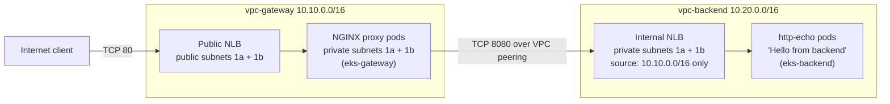

# Rapyd Sentinel — Split Architecture PoC

Two isolated AWS VPCs, one EKS cluster in each, connected privately through VPC peering. A public NGINX proxy in the **gateway** cluster forwards requests to an internal service in the **backend** cluster, which is never exposed to the internet. Everything is provisioned and deployed by GitHub Actions.

```
curl http://<gateway NLB hostname>
Hello from backend
```

Region: `eu-central-1` · AZs: `eu-central-1a`, `eu-central-1b` · Kubernetes 1.31 · Terraform 1.10.3

---

## Architecture



| Component | vpc-gateway | vpc-backend |
| --- | --- | --- |
| VPC CIDR | 10.10.0.0/16 | 10.20.0.0/16 |
| Private subnets (EKS nodes, pods) | 10.10.10.0/24 (1a), 10.10.11.0/24 (1b) | 10.20.10.0/24 (1a), 10.20.11.0/24 (1b) |
| Public subnets (NAT, public NLB) | 10.10.0.0/24 (1a), 10.10.1.0/24 (1b) | 10.20.0.0/24 (1a), 10.20.1.0/24 (1b) |
| NAT Gateway | 1 (in 1a) | 1 (in 1a) |
| EKS cluster | `eks-gateway`, 2 × t3.medium | `eks-backend`, 2 × t3.medium |
| Workload | NGINX reverse proxy, 2 replicas | `hashicorp/http-echo`, 2 replicas |
| Exposure | Internet-facing NLB, port 80 | Internal NLB, port 8080 |

**No public EC2 instances.** Worker nodes live only in private subnets (`map_public_ip_on_launch = false`). The only public endpoints are managed services: the NAT Gateways and the gateway NLB.

---

## Repository layout

```
terraform/
  bootstrap/              # one-off: GitHub OIDC deploy role (see "Limitations")
  environments/sandbox/   # root module: wires the modules together
  modules/
    vpc/                  # VPC, subnets, IGW, NAT, route tables, ELB subnet tags
    peering/              # VPC peering + routes in both private route tables
    eks/                  # cluster, node group, IAM roles, access entries,
                          # Pod Identity + IAM role for the AWS LB Controller
k8s/
  backend/                # namespace, http-echo Deployment, internal NLB Service
  gateway/                # namespace, NGINX ConfigMap (templated), Deployment, public NLB Service
scripts/                  # helpers used by the workflows
.github/workflows/
  deploy.yml              # main pipeline (push to main)
  diagnose.yml            # manual: read-only health check of the whole path
  oidc-debug.yml          # manual: OIDC federation troubleshooting
```

### Terraform modules

| Module | Key inputs | Key outputs |
| --- | --- | --- |
| `vpc` | `name_prefix`, `vpc_cidr`, `azs`, `public_subnet_cidrs`, `private_subnet_cidrs`, `tags` | `vpc_id`, `vpc_cidr`, `private_subnet_ids`, `public_subnet_ids`, `private_route_table_id`, `nat_gateway_id` |
| `peering` | `requester_vpc_id`, `accepter_vpc_id`, both CIDRs, both private route table IDs | `peering_connection_id` |
| `eks` | `cluster_name`, `cluster_version`, `vpc_id`, `private_subnet_ids`, node sizing, `allowed_peer_cidr_blocks`, `allowed_peer_port` | `cluster_name`, `cluster_endpoint`, `cluster_ca_certificate`, `node_role_arn` |

State is stored remotely in Terraform Cloud (organization `sentinel-leoblackbeard`, workspace `sentinel-sandbox`).

---

## How to clone and run

### Prerequisites

- An AWS account and IAM credentials with the permissions provided for this challenge.
- A Terraform Cloud organization/workspace and an API token.
- GitHub repository secrets:

| Secret | Purpose |
| --- | --- |
| `AWS_ACCESS_KEY_ID`, `AWS_SECRET_ACCESS_KEY` | AWS access for the pipeline |
| `TF_API_TOKEN` | Terraform Cloud remote state |
| `AWS_ROLE_ARN` | OIDC deploy role (only for `oidc-debug.yml`; see Limitations) |

### Deploy

```bash
git clone https://github.com/leoblackbeard/Sentinel_Sandbox.git
cd Sentinel_Sandbox
# make a change, then:
git push origin main
```

Every push to `main` runs the full pipeline. It can also be started manually from **Actions → Sentinel Deploy → Run workflow**. Terraform is never applied from a local machine (the one exception is the bootstrap role; see Limitations).

### Verify

The `validate-e2e` job does this automatically. Manually:

```bash
HOST=$(aws elbv2 describe-load-balancers --names sentinel-gateway-nlb \
  --query 'LoadBalancers[0].DNSName' --output text)
curl http://$HOST        # -> Hello from backend
```

For a full read-only health report (NLB AZs, target health, security groups, routes, in-pod tests), run **Actions → Diagnose e2e → Run workflow** (~1 minute).

---

## Networking between the VPCs and clusters

1. **Non-overlapping CIDRs** (10.10.0.0/16 and 10.20.0.0/16), a prerequisite for peering.
2. **VPC peering** (`modules/peering`), same account and region, `auto_accept = true`. Traffic stays on the AWS backbone and never touches the internet.
3. **Routes.** Each VPC's private route table has `0.0.0.0/0 → NAT Gateway` plus `<other VPC CIDR> → peering connection`. Pods use the VPC CNI, so pod IPs are VPC IPs and are routed like any other address.
4. **Subnet tags** let the AWS Load Balancer Controller place load balancers: `kubernetes.io/role/elb` on public subnets and `kubernetes.io/role/internal-elb` on private subnets.

## How the proxy reaches the backend

1. A client calls the gateway NLB hostname on port 80. The NLB is `internet-facing`, spans both public subnets, has cross-zone load balancing enabled, and forwards to NGINX pod IPs (`nlb-target-type: ip`).
2. NGINX runs `proxy_pass http://<internal NLB hostname>:8080`. The pipeline injects the hostname into the ConfigMap with `envsubst` after the backend NLB is provisioned.
3. The internal NLB hostname resolves to private 10.20.x.x addresses. The gateway's private route table sends 10.20.0.0/16 through the peering connection.
4. The internal NLB accepts the connection only from 10.10.0.0/16 and forwards it to the http-echo pods, which answer `Hello from backend`.
5. The reply follows the reverse route (backend private route table: 10.10.0.0/16 → peering).

### Security groups: the backend accepts traffic only from the gateway VPC

| Layer | Rule |
| --- | --- |
| Backend NLB (internal) | Scheme `internal`: no public address at all |
| Backend NLB security group | Ingress TCP 8080 **only from 10.10.0.0/16**, via `loadBalancerSourceRanges` in `k8s/backend/02-service.yaml` (by default an internal NLB only allows its own VPC) |
| Backend cluster security group | Ingress TCP 8080 from the NLB security group (managed by the controller) and from 10.10.0.0/16 (Terraform, `allowed_peer_cidr_blocks`) |
| Gateway NLB security group | Ingress TCP 80 from 0.0.0.0/0, because it is the public entry point |

### AWS Load Balancer Controller

Both clusters run the AWS Load Balancer Controller, which turns `type: LoadBalancer` Services into NLBs.

- **Permissions** come from **EKS Pod Identity**. Terraform creates the `eks-pod-identity-agent` add-on, the `eks-<cluster>-lbc-role` IAM role (inline policy, upstream `iam_policy.json`), and the association with `kube-system/aws-load-balancer-controller`.
- Node-role credentials are not an option on AL2023, because the IMDSv2 hop limit is 1 and pods cannot reach it. IRSA would need an IAM OIDC provider per cluster.
- **Installation**: `scripts/install-lbc.sh` installs the Helm chart with explicit `clusterName`, `region` and `vpcId`, and with `keepTLSSecret=true`.

---

## CI/CD pipeline (`.github/workflows/deploy.yml`)

Trigger: `push` to `main` (and `workflow_dispatch`). A `concurrency` group prevents two applies from running at the same time.

| Job | Steps |
| --- | --- |
| `terraform` | `init` → `validate` → `plan -out=tfplan` → `apply tfplan` → export cluster names and VPC IDs as job outputs |
| `deploy-backend` | kubeconfig → install/upgrade LB Controller → apply `k8s/backend/` → wait for rollout → wait for the internal NLB hostname |
| `deploy-gateway` | kubeconfig → install/upgrade LB Controller → render NGINX ConfigMap with the backend hostname → apply `k8s/gateway/` → restart NGINX only if its ConfigMap changed → wait until the pods are healthy in the NLB → wait for the public NLB hostname |
| `validate-e2e` | up to 40 × `curl` the public NLB, expecting `Hello from backend`, logging live target health on every attempt. On failure, `scripts/diagnose-e2e.sh` dumps NLB AZs, target health, security groups and routes, and tests each leg from inside an NGINX pod |

Both namespaces carry the label `elbv2.k8s.aws/pod-readiness-gate-inject: enabled`. The controller then adds a readiness gate to every pod: a pod only counts as Ready once the NLB reports it healthy, so `kubectl rollout status` waits for real traffic and a rollout never removes old pods before the new ones are serving.

Values flow between jobs through job `outputs`, because each job runs on a fresh runner.

---

## Trade-offs and limitations

### Decisions made for the time limit

| Decision | Why | Cost / risk | Production alternative |
| --- | --- | --- | --- |
| One NAT Gateway per VPC | Half the NAT cost; meets the requirement | Losing AZ 1a removes outbound internet for nodes in 1b | One NAT per AZ |
| VPC peering | Simple, no hourly charge | Does not scale to many VPCs; non-transitive | Transit Gateway, or PrivateLink for service-level exposure |
| Backend hostname injected with `envsubst` | No shared DNS or mesh needed | A recreated backend NLB requires redeploying the gateway | Route 53 private hosted zone with a stable name |
| Public EKS API endpoint | GitHub-hosted runners must reach `kubectl` | Larger attack surface | Private endpoint + self-hosted runners in the VPC |
| Plan and apply in the same run | Fast iteration | No human review of the plan | Plan on PR, apply on merge with a protected environment |
| Static AWS keys in CI | OIDC role assumption is denied (below) | Long-lived credentials | GitHub OIDC federation |

### Permission constraints encountered

| Constraint | Impact | Workaround applied | In a real environment |
| --- | --- | --- | --- |
| `iam:CreatePolicy` denied | No customer-managed policies | Inline policies on the `eks-*` roles | Versioned managed policies owned by a platform team |
| Only `eks-*` / `sentinel-*` roles can be created or passed | Role names are constrained | `eks-<cluster>-{cluster,node,lbc}-role`, `sentinel-leoblackbeard-gha-deploy` | Same; it is a sensible guardrail |
| `sts:AssumeRoleWithWebIdentity` denied for the OIDC role | The pipeline cannot use OIDC | Static IAM user keys stored as GitHub secrets | Fix the trust/guardrail and remove static keys |

### GitHub OIDC (bonus): status

- The GitHub OIDC provider exists in the account (audience `sts.amazonaws.com`).
- The role `sentinel-leoblackbeard-gha-deploy` trusts `repo:leoblackbeard/Sentinel_Sandbox:*`.
- `AWS_ROLE_ARN` was verified to match the role.
- Despite that, `AssumeRoleWithWebIdentity` returns `AccessDenied`. `oidc-debug.yml` prints the token claims and calls STS directly to isolate the cause. The remaining candidates are a claim mismatch in the trust policy or an account-level guardrail outside this repository.

### Local applies (honest disclosure)

`terraform/bootstrap` creates the OIDC deploy role that the pipeline would assume, so it cannot be applied by that same pipeline (chicken-and-egg). It was applied once from a local machine on 2026-10-10, and again on 2026-10-11 to extend its policy for the LB Controller roles. The second apply was unnecessary in hindsight, because the pipeline uses static keys. Everything under `terraform/environments/` is applied only by GitHub Actions.

### Issues found and fixed along the way

- **Services stuck in `<pending>`**: the manifests target the AWS Load Balancer Controller (`aws-load-balancer-type: external`), which was not installed. Fixed by installing it with Pod Identity.
- **Public NLB in a single AZ**: with only one public subnet, NGINX pods in the other AZ were `Target.NotInUse`. A second public subnet was added; `moved` blocks kept the existing subnet and NAT intact. The controller keeps an existing NLB's subnets unless the `aws-load-balancer-subnets` annotation is set, so both subnets are now pinned explicitly.
- **Controller webhook certificate rotated on every `helm upgrade`** (`x509: certificate signed by unknown authority`), which stalled target registration. Fixed with `keepTLSSecret=true`.
- **Intermittent e2e timeouts after green deploys**: every run restarted NGINX (new pod IPs) and the controller, so the public NLB had to re-register targets while `validate-e2e` was already probing it. Fixed by restarting NGINX only when its config changes and by pod readiness gates, so the deploy job finishes only when the NLB has healthy targets.

---

## What I would add next

- **TLS** on the public NLB (ACM certificate, TLS listener) and HTTPS redirect.
- **OIDC federation** in CI instead of static keys.
- **Observability**: CloudWatch Container Insights or Prometheus + Grafana, NLB and VPC Flow Logs, alarms on unhealthy targets.
- **NetworkPolicies** inside each cluster (e.g. only the NGINX pods may egress to 10.20.0.0/16).
- **Service mesh / mTLS** between clusters (or PrivateLink) for zero-trust service-to-service traffic.
- **HA networking**: one NAT Gateway per AZ.
- **Pipeline hardening**: plan on pull requests, manual approval before apply, `tflint` and `kubectl apply --dry-run=server` gates, Helm chart version pinning, reusable composite actions.
- **Autoscaling**: Cluster Autoscaler or Karpenter, and HPA on the proxy.
